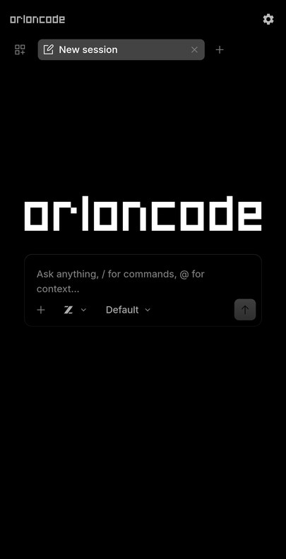
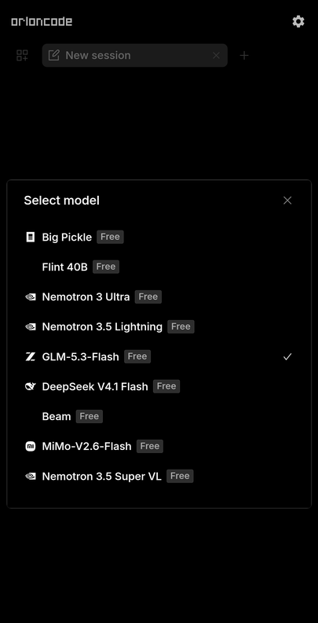
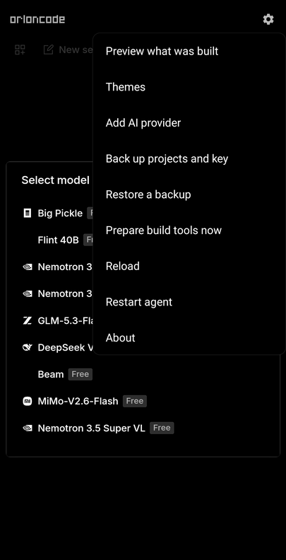

# Orlon Code

**AI-powered coding, directly from your phone. Standalone, open source, free coding agents.**

**Vibecode on your phone.** Orlon Code runs the [OpenCode](https://opencode.ai) coding agent entirely on an Android phone, with
no computer, server, or tunnel. Ask for an app, and it writes it, builds a real APK on the phone, and offers to install it.

- **Everything on the phone.** The agent and its Linux sandbox live in the app's private storage. Only the AI model is remote.
- **Builds Android apps.** JDK 17 + Android SDK 36 install themselves on the first build; Gradle, `aapt2` and signing all run locally.
- **Tap to install.** When an APK is ready you get an install banner (or a notification); APK paths in the chat are tappable.
- **AMOLED black by default.** Pure-black surfaces; the model picker shows each model maker's real logo (fetched from [models.dev](https://models.dev)).
- **Themes.** `/themes` (or Settings > Themes) switches between all of OpenCode's themes; the whole app follows.
- **Preview.** Settings > Preview what was built shows web projects (or any local dev-server port).
- **Free models included.** OpenCode's free models work out of the box; Settings > Add AI provider connects your own API keys.
- **Your work is yours.** Settings > Back up projects and key saves one zip; the projects folder also shows up in Android's Files app.

<p align="center">
  
  
  
</p>

> Orlon Code is an independent project and is not affiliated with the OpenCode project.

## Requirements

An arm64 Android phone (Android 8 or newer) with about 2 GB free for the sandbox (more for app builds: the Android SDK and
Gradle caches take roughly 3 GB), and an internet connection.

## Install

Download the APK from the project's Releases page and open it (allow "install unknown apps" for your browser or file
manager). On first launch tap **Get Started**; it downloads about 100 MB once.

Build from source instead:

```bash
./gradlew assembleDebug            # needs JDK 17 and Android SDK platform 36
```

See [CONTRIBUTING.md](CONTRIBUTING.md) for tests, signing a release, and developing on a device.

## Using it

1. Open the app; you land on the prompt box. Pick a model if you like.
2. Ask for something: *"Make a tip calculator Android app and build the APK."* The first build installs the build tools by
   itself (about 750 MB, a few minutes).
3. When the build finishes, tap **Install** on the banner, or tap the APK path in the chat.

Projects live in the sandbox at `/root/projects`. Release builds are signed with a key created on the phone; keep the app
installed (or you lose the key) if you need to publish updates under the same signature.

## How it works

`libproot.so` (proot, shipped as a native library) starts an Alpine Linux arm64 root filesystem in app storage, and OpenCode
runs inside it as a local web server on `127.0.0.1` protected by a random per-install password. The app shows OpenCode's web UI
in a WebView with phone-fit fixes and branding. Small shell tools in the sandbox (`orlon-new-android`, `orlon-build`,
`orlon-toolchain`) give the agent a one-command path from idea to APK. Details: [docs/ARCHITECTURE.md](docs/ARCHITECTURE.md).

## Releases and signing

Release APKs are signed with one key. Check that an APK is genuine: its certificate SHA-256 should be

```
19:31:50:d1:4d:cc:78:13:30:b3:79:97:57:3e:e6:bc:9f:ec:3c:c7:8b:c1:e2:d3:a5:0c:33:ab:fe:69:9e:f2
```

(`apksigner verify --print-certs OrlonCode.apk`). Each release also lists the file's SHA-256 in its notes.

## Known issues

- Models from makers without a bundled logo show no icon in the picker.
- The first build still downloads about 750 MB if you skipped the background preparation or were on mobile data.
- If Android stops the app while it is in the background, a build in progress is lost; allow background activity when asked.
- A backup does not include your AI provider keys; connect them again after restoring on a new phone.

## Roadmap

Private Git repositories, NDK/CMake builds, a built-in file browser and editor, and an x86_64/armeabi build for emulators.
Ideas and pull requests are welcome, see [CONTRIBUTING.md](CONTRIBUTING.md).

## Limitations

- arm64 phones only. Models run in the cloud, so you need a connection to prompt.
- The first build of each project downloads its libraries; very large projects may not fit in memory.
- Android builds only for now (no NDK/CMake). Private Git repositories are not supported.
- The app styles OpenCode's web interface by injecting small scripts, so a large OpenCode redesign may need updates here.

## License

Apache License 2.0, see [LICENSE](LICENSE). Bundled and downloaded components keep their own licenses: see
[THIRD_PARTY_NOTICES.md](THIRD_PARTY_NOTICES.md) (this includes GPL/LGPL components and how to get their source).
